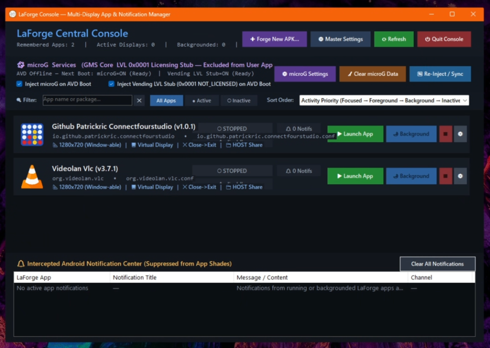
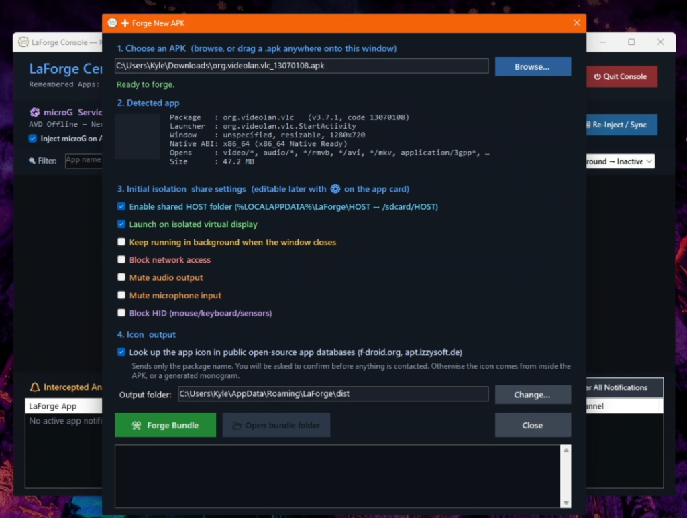
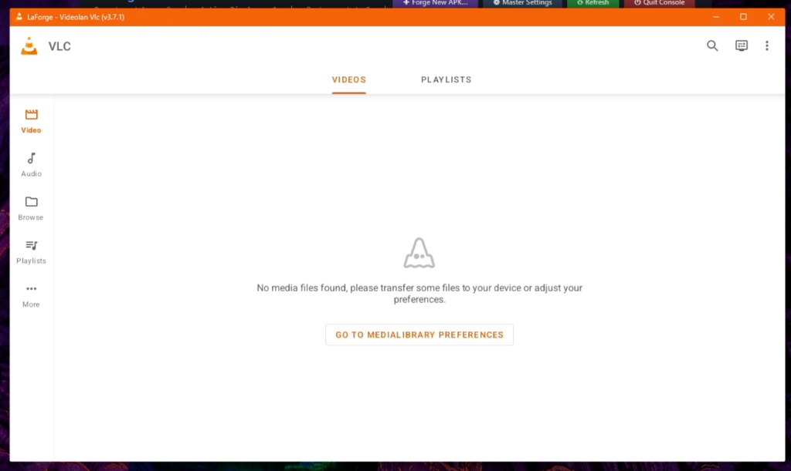
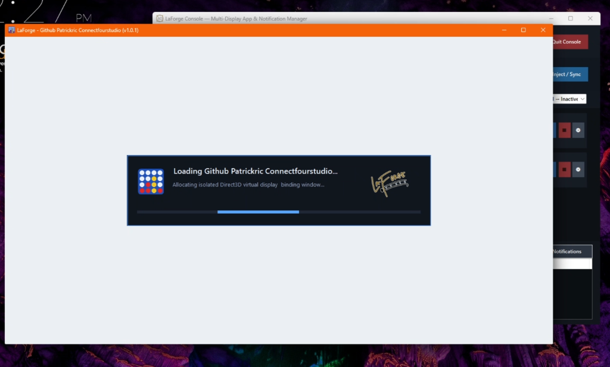
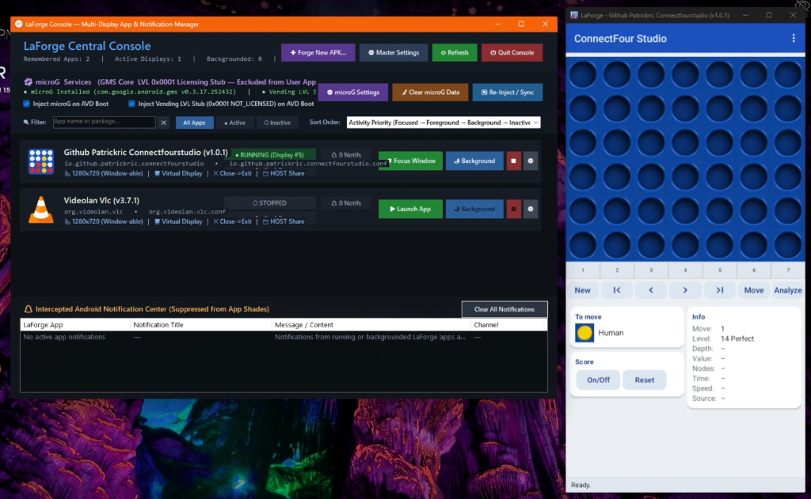

<p align="center">
  
</p>
# LaForge 🚀

> **Turn any Android APK into a native-feeling Windows desktop application.**  
> Seamless, isolated, high-performance Android app execution on Windows with zero terminal clutter.

---

## ✨ Features

- **Native Windows Desktop Experience**: Each forged APK gets its own dedicated Windows shortcut, icon, and native window border—running just like a standard desktop program.
- **Zero-Console Subsystem**: Pure Win32 GUI subsystem execution (`WinExe`) with no lingering command-prompt windows or black terminal boxes.
- **High-Performance Virtualization Backend**: Powered by a streamlined, headless Android 14 (API 34) x86_64 emulator instance with ultra-low latency `scrcpy` display bridging.
- **ARM64 Translation Built-In**: Integrated with Google `libndk_translation` v0.2.3, allowing modern 64-bit ARM (`arm64-v8a`) native apps and games to run smoothly on x86_64 Windows PCs without emulation slowdowns.
- **Automatic Runtime Provisioning**: Self-contained installer can download and verify the pinned Android runtime (emulator + system image) on first install, or provision automatically on first launch.
- **MicroG & Play Services Compatibility**: Out-of-the-box support for microG and Play Services stubs, enabling apps that require Google mobile services.
- **LaForge Console & App Manager**: Central dashboard (`LaForgeConsole.exe`) to forge new APKs, configure per-app display resolutions/bitrates, inspect installed apps, and manage VM state.
- **Clean Uninstaller**: Full uninstaller integration with Windows Installed Apps (`Add or Remove Programs`), Start Menu shortcut cleanup, and optional removal of forged app containers and virtual disk images.

---

## 📸 App in Action

### 1. LaForge Console
*LaForge Central Console displaying managed apps, virtualization controls, and the Android notification center.*  


### 2. "Forge New APK…" Dialog
*A populated "Forge New APK..." dialog with automatic package inspection, ABI detection, isolated display configuration, and host folder sharing.*  


### 3. VLC Running in LaForge
*VLC for Android executing seamlessly inside a native desktop window with direct audio and input routing.*  


### 4. Branded Loading Splash Screen
*Patrickric's ConnectFour Studio launching with splash screen overlay while allocating the isolated Direct3D virtual display.*  


### 5. Multi-Window Multitasking & Status Tracking
*The ConnectFour app running in a manually-resized portrait window beside LaForge Console showing the app's live active status.*  


---

## 📥 Getting Started

### Installation
1. Download the latest **`LaForgeSetup.exe`** from the [Releases](https://github.com/releases) tab.
2. Run the setup wizard.
3. Choose whether to download the Android runtime during setup (recommended, ~1.2 GB) or let LaForge download it automatically when you launch your first forged app.
4. Launch **LaForge Console** from your Start Menu or Desktop.

### Forging Your First App
1. Open **LaForge Console**.
2. Click **Forge APK** (or drag and drop an `.apk` file into the window).
3. Set your desired display orientation (Phone / Tablet / Freeform) and shortcut names.
4. Click **Forge!** — LaForge packages a standalone `.exe` launcher and places shortcuts on your Desktop and Start Menu.
5. Launch the app whenever you want, just like any other Windows application!

---

## 🛠️ Architecture

```
[ Your Windows Desktop ]
        │
   [ App.exe ] (Native WinExe Stub)
        │
   [ scrcpy bridge + custom window controls ]
        │
   [ Headless Android 14 x86_64 VM ]
   ├── Google libndk_translation (ARM64 -> x86_64)
   └── microG / GMS Services Shim
```

### Components
- **`LaForge.Launcher`**: Ultra-lightweight C# .NET 8 native WinExe that boots the headless VM daemon (if not already running) and bridges the display directly to a dedicated scrcpy window.
- **`LaForge.Console`**: WinForms control panel for managing apps, VM status, ADB bridges, and forging new APK packages.
- **`LaForge.Installer`**: Self-contained single-file installer wizard that handles shortcuts, Windows registry registration, and runtime provisioning.
- **`RuntimeProvisioner`**: Downloads pinned Android emulator (`37.2.12`), platform-tools (`37.0.1`), and Android 14 system image (`x86_64-34_r04.zip`) verified with SHA-256 integrity checks.

---

## 🏗️ Building from Source

### Prerequisites
- Windows 10 (1809+) or Windows 11 (x64)
- [.NET 8.0 SDK](https://dotnet.microsoft.com/download/dotnet/8.0)
- PowerShell 7+ or Windows PowerShell 5.1

### Build Instructions
To build and publish single-file release binaries and the installer:

```powershell
# Clone the repository
git clone https://github.com/<your-username>/LaForge.git
cd LaForge

# Run the automated release build script
pwsh -ExecutionPolicy Bypass -File .\scripts\build_release.ps1 -Deploy
```

The compiled binaries will be output to:
- `publish/launcher/launcher.exe`
- `publish/installer/LaForgeSetup.exe`
- Root workspace `LaForgeConsole.exe` and `LaForgeSetup.exe`

---

## 📄 License
This project is licensed under the Apache 2.0 License. See [LICENSE](LICENSE) for details.
