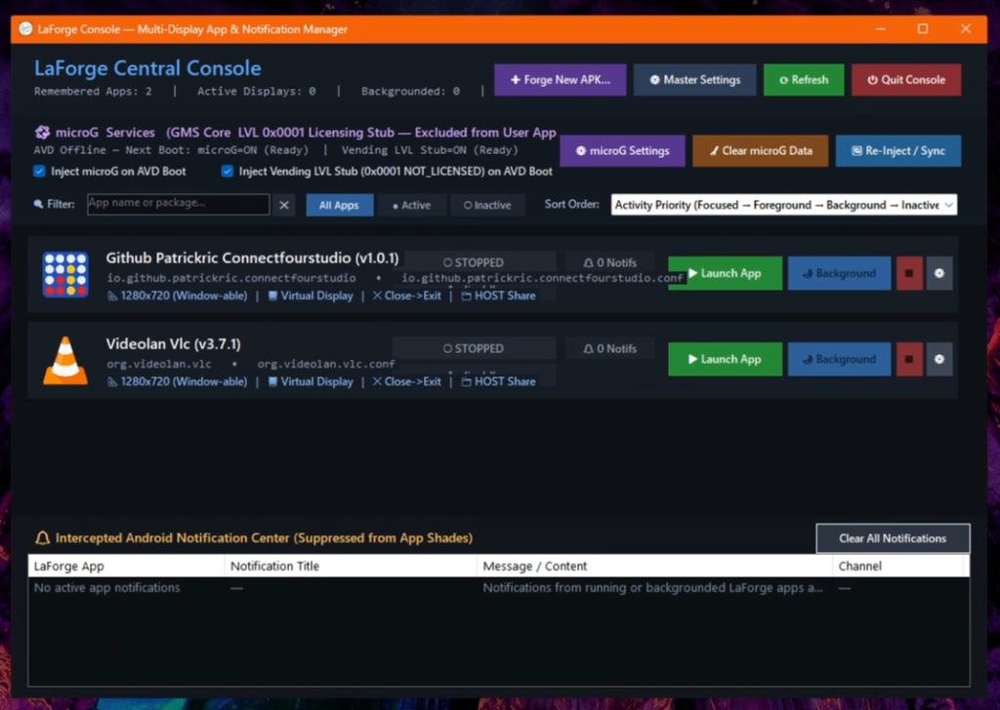
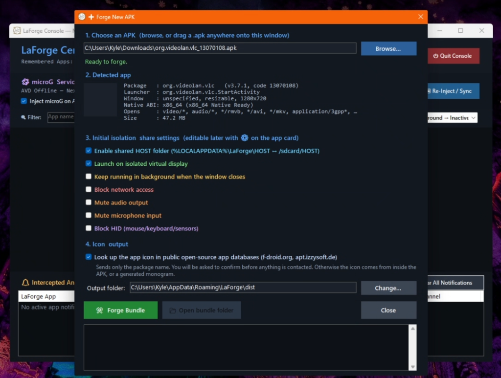
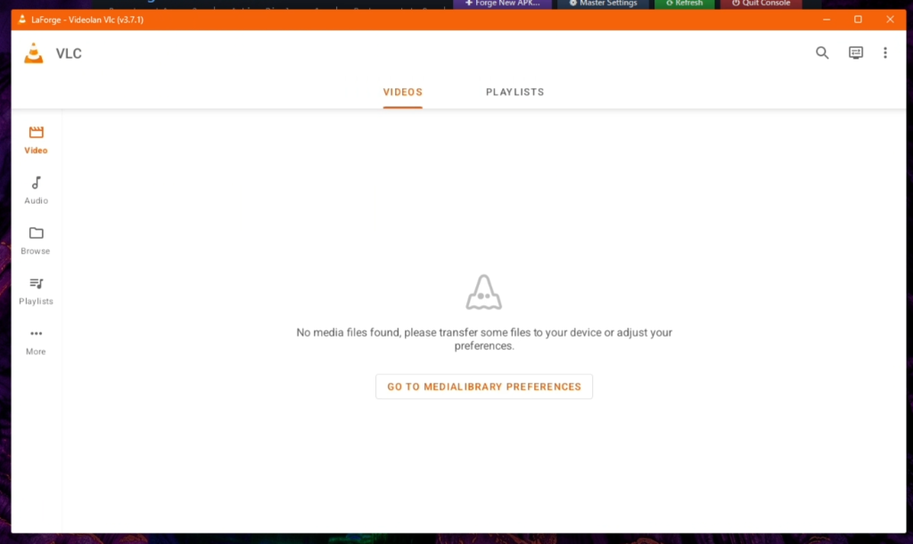
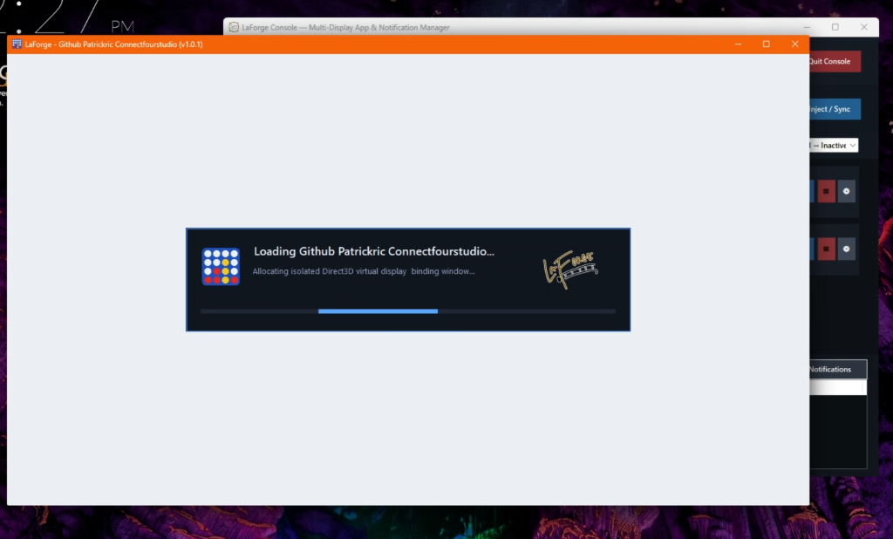
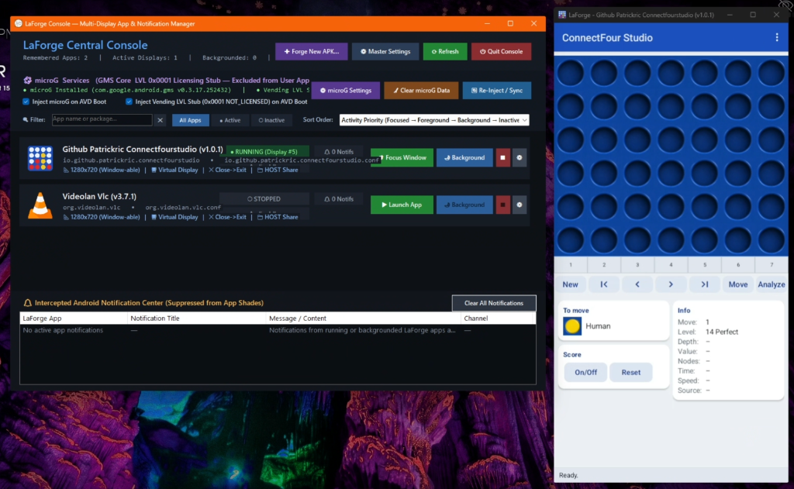

<table>
  <tr>
    <td align="left" valign="middle">
      <h1>LaForge</h1>
      <p><strong>Turn any Android APK into a native-feeling Windows desktop application.</strong><br>
      Shared-pool multi-display virtualization, real-time desktop notification bridging, persistent app backgrounding, and direct LAN access—with zero terminal clutter.</p>
    </td>
    <td align="center" valign="middle" width="30%">
      
    </td>
  </tr>
</table>

---

## ✨ Key Features

- **Native Windows Desktop Experience**: Each forged APK gets its own dedicated Windows `.exe` launcher, custom icon, Start Menu / Desktop shortcuts, and native window border—running side-by-side like standard desktop software.
- **Shared State Pool & Per-App Virtual Displays**: Forged apps run inside a **shared Android 14 (`API 34`) state pool** by default rather than spinning up redundant VMs per app. Each open app is bound to its own independent, hardware-accelerated **SDL3 / Direct3D virtual display (`--new-display`)** so multiple apps can run simultaneously in separate desktop windows while sharing a single lightweight runtime footprint.
- **Automatic Resource Hibernation & Persistent Backgrounding**:
  - **Zero-Overhead Idle Hibernation**: When all forged apps are closed, LaForge automatically hibernates the headless emulator—dropping background CPU and RAM usage to **zero**—and resumes in seconds from a pre-warmed `default_boot` snapshot when needed.
  - **Per-App Persistent Background Mode (`0ms` Restore)**: Apps that need continuous 24/7 operation (such as security camera monitors, smart-home controllers, or messaging clients) can be **backgrounded** on close or directly from the Console. Backgrounded apps remain active in the shared pool with automatic Android Doze exemption (`deviceidle whitelist`) while releasing desktop rendering resources, and restore to the screen in **`0ms`**.
- **Integrated Notification Center & Real-Time Push (FCM / microG)**:
  - **Console Notification Center**: LaForge suppresses intrusive Android notification shades inside individual app windows and routes all app alerts directly into the **LaForge Console Notification Center** and Windows system tray—complete with per-app unread badges, notification title/body/channel history, and 1-click clearing.
  - **Full Push & GMS Interop**: Includes an AOSP system-level signature spoofing patch (`LaForgeSpoof`), **microG GmsCore** with active **Firebase Cloud Messaging (FCM / GCM)** push token registration, automatic `POST_NOTIFICATIONS` permission grants, and a built-in Google Play Licensing interop module (`LaForge.VendingStub`).
- **Joined to Your Local Network (LAN) by Default**: Unlike consumer gaming emulators that trap apps behind isolated virtual switches, LaForge joins managed apps to your host LAN context by default—allowing seamless local discovery and direct connections to IP cameras, NVRs, smart-home devices, and local servers. If you ever want to sandbox an app offline, LaForge Console provides a live per-app UID firewall toggle (`iptables` / `netpolicy`) alongside per-app Audio, Microphone, and HID input locks.
- **ARM64 Translation Built-In**: Integrated with Google `libndk_translation` (`v0.2.3`), allowing modern 64-bit ARM (`arm64-v8a`) native apps and camera/media codecs to execute smoothly on `x86_64` Windows PCs.
- **Host Hardware & Filesystem Bridges**: Built-in host webcam passthrough (configurable Front/Rear cameras), microphone bridge (`hostmicon`), raw low-latency PCM audio routing, UHID gamepad passthrough, GPS geolocation bridge (`adb emu geo fix`), and an automatic two-way `/sdcard/HOST` ↔ `%LOCALAPPDATA%\LaForge\HOST` shared folder.
- **Clean Uninstaller**: Full integration with Windows Installed Apps (`Add or Remove Programs`), Start Menu cleanup, and optional removal of forged app launchers and runtime images.

---

## 📸 App in Action

### 1. LaForge Console & Notification Center
*LaForge Central Console displaying managed apps, live foreground/background telemetry, per-app policy toggles, and the intercepted Android Notification Center.*  


### 2. "Forge New APK..." Dialog
*A populated "Forge New APK..." dialog with automatic package inspection, ABI detection, isolated display configuration, and host folder sharing.*  


### 3. VLC Running in LaForge
*VLC for Android executing seamlessly inside a native desktop window with direct audio and input routing.*  


### 4. Branded Loading Splash Screen
*Patrickric's ConnectFour Studio launching with splash screen overlay while allocating the isolated Direct3D virtual display.*  


### 5. Multi-Window Multitasking & Status Tracking
*The ConnectFour app running in a manually-resized portrait window beside LaForge Console showing the app's live active status.*  


---

## 🚀 Getting Started

### Installation
1. Download the latest **`LaForgeSetup.exe`** from the [Releases](https://github.com/blainekyle/LaForge/releases) page.
2. Run the setup wizard.
3. Choose whether to download the Android runtime during setup (recommended, ~1.2 GB) or let LaForge provision it automatically when you launch your first forged app.
4. Launch **LaForge Console** from your Start Menu or Desktop.

### Forging Your First App
1. Open **LaForge Console**.
2. Click **Forge APK** (or drag and drop an `.apk` file into the window).
3. Choose your desired display profile (Phone / Tablet / Freeform), orientation, and shortcut options.
4. Click **Forge!** — LaForge packages a standalone `.exe` launcher and places shortcuts on your Desktop and Start Menu.
5. Launch the app anytime just like a native Windows program, or toggle **Background** in LaForge Console to keep it running persistently for push notifications and instant `0ms` window restoration.

---

## 🏗️ Architecture

```text
[ Windows Desktop & System Tray ]
        │
        ├──► [ App.exe ] (Native WinExe Stub per Forged App)
        │         │
        │         ▼
        │    [ Local Loopback SDL3 / Direct3D Virtual Display Bridge ]
        │    • Independent per-app virtual display (--new-display)
        │    • 0ms instant restore from persistent background state
        │
        └──► [ LaForgeConsole.exe ] (App Manager & Notification Center)
                  │
                  ▼
        [ Shared Headless Android 14 (API 34) Runtime Pool ]
        • Auto-hibernates to 0% CPU/RAM when idle; fast-resumes via snapshot
        • Default Host LAN connectivity + optional per-UID iptables firewall
        • Google libndk_translation (ARM64 -> x86_64 native execution)
        • AOSP Signature Spoofing + microG (FCM/GCM push) + VendingStub
        • Host Webcam, Mic, Raw PCM Audio, GPS & /sdcard/HOST Folder Bridges
```

### Components
- **`LaForge.Launcher`**: Lightweight C# .NET 8 native `WinExe` that wakes the shared headless runtime pool from its `default_boot` snapshot (if hibernated), allocates an isolated Direct3D virtual display, and manages `0ms` background restoration and auto-hibernation on exit.
- **`LaForge.Console`**: WinForms control panel and system-tray host for forging APKs, monitoring live foreground/background/audio states, enforcing per-app firewall/audio/mic/HID policies, configuring hardware bridges (cameras, GPS, gamepad), and surfacing intercepted Android push notifications.
- **`LaForge.VendingStub` & `GmsInteropManager`**: Pairs AOSP `services.jar` signature spoofing (`LaForgeSpoof`) and microG cloud messaging with a custom Play Licensing stub and automatic Doze whitelisting for reliable background push delivery.
- **`LaForge.Installer` & `RuntimeProvisioner`**: Self-contained single-file installer wizard that provisions the pinned Android emulator (`37.2.12`), platform-tools (`37.0.1`), and Android 14 system image (`x86_64-34_r04.zip`) verified with SHA-256 integrity checks.

---

## 🛠️ Building from Source

### Prerequisites
- Windows 10 (1809+) or Windows 11 (x64)
- [.NET 8.0 SDK](https://dotnet.microsoft.com/download/dotnet/8.0)
- PowerShell 7+ or Windows PowerShell 5.1

### Build Instructions
To build and publish single-file release binaries and the installer:

```powershell
# Clone the repository
git clone https://github.com/blainekyle/LaForge.git
cd LaForge

# Run the automated release build script
pwsh -ExecutionPolicy Bypass -File .\scripts\build_release.ps1 -Deploy
```

The compiled binaries will be output to:
- `publish/launcher/launcher.exe`
- `publish/installer/LaForgeSetup.exe`
- Root workspace `LaForgeConsole.exe` and `LaForgeSetup.exe`

---

## 📄 License
This project is licensed under the Apache 2.0 License. See [LICENSE](LICENSE) for details.